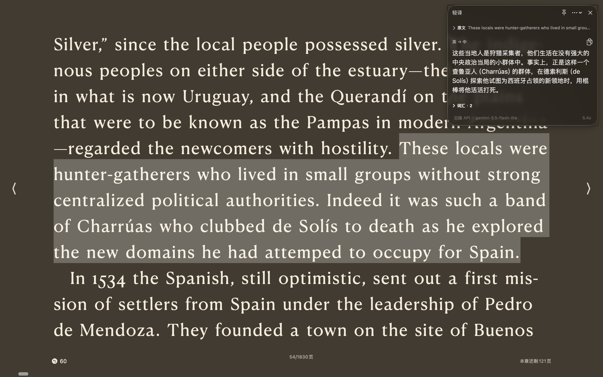
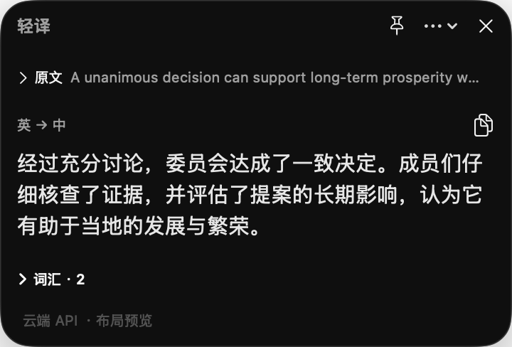
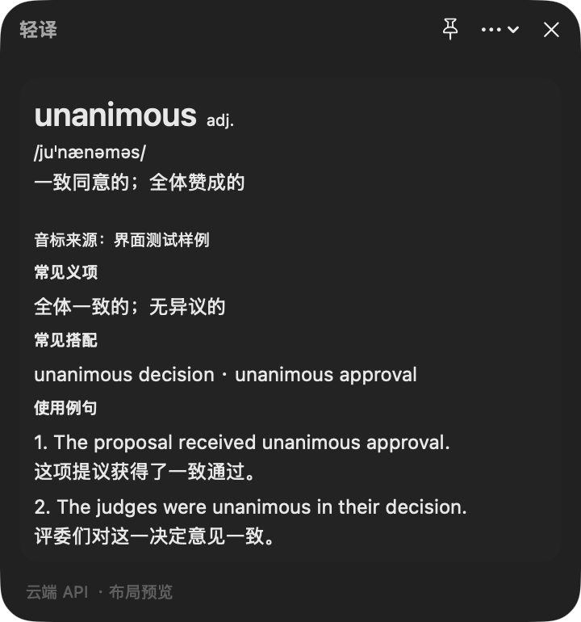

# 轻译 · LightTranslate

原生 macOS 中英翻译工具。划选一句话，读懂译文；划选一个英文单词，直接查看解释。

[下载最新版本](https://github.com/andy1613785214/light-translate/releases/latest) · Apple Silicon · macOS 14+

## 1. 功能介绍与演示

- **中英双向翻译**：自动识别方向，也可手动选择中译英或英译中，单次最多 3,000 字符。
- **划句翻译**：划选文字后按快捷键，浮窗显示译文；原文和难词默认折叠，最多展示 5 个难词或短语。
- **划词解释**：选中单个英文词后，直接展开美式音标、词性、释义、常见义项、搭配，以及 2 个例句和中文翻译。
- **小巧浮窗**：默认出现在当前屏幕右上角，等待时只有一行“正在翻译”，结果返回后再展开；长内容可滚动查看。
- **随手操作**：支持复制译文、固定浮窗、修改快捷键和 `Esc` 关闭；也可手动粘贴文字。
- **原生玻璃效果**：macOS 26 使用 Liquid Glass，macOS 14/15 使用系统磨砂材质，适配浅色与深色模式。

### 阅读场景演示

阅读时划选句子，按快捷键，译文便出现在屏幕右上角：



*阅读场景截图由用户提供，展示实际使用效果。*

### 使用流程

**划选文字 → 按 `⌥ Space` → 等待 → 查看结果。** 已自定义快捷键的用户使用自己的设置。

等待时：


<table>
  <tr>
    <th align="left">划句子：显示译文，词汇默认折叠</th>
    <th align="left">划单词：直接展开详细解释</th>
  </tr>
  <tr>
    <td valign="top"></td>
    <td valign="top"></td>
  </tr>
</table>

以上三张独立窗口图片为应用真实截图，使用固定样例展示布局，不代表某个云端模型的翻译质量。玻璃效果会随背景和系统外观变化。

音标优先使用内置美式词表；释义、词性和例句由模型生成，可能存在错误。缺失字段显示“暂不可用”。目前不包含 OCR、扫描 PDF、全文文档翻译、朗读或生词本。

## 2. 安装和配置方法

### 安装

1. 打开 [最新 Release](https://github.com/andy1613785214/light-translate/releases/latest)，下载 `LightTranslate-版本-arm64.dmg`。
2. 打开 DMG，将“轻译”拖入 **Applications（应用程序）**。已有旧版时，先从菜单栏退出轻译，再替换。
3. 从“应用程序”启动轻译，点击菜单栏图标，打开 **设置**。也可下载 ZIP，解压后将应用放入“应用程序”。

当前发布版采用 ad-hoc 签名，尚未进行 Developer ID 签名或苹果公证。首次打开若被 macOS 拦截，请先确认文件来自本仓库，再按照 [Apple 官方说明](https://support.apple.com/zh-cn/102445) 在“系统设置 → 隐私与安全性”中处理提示。

### 配置云端翻译

在 **设置 → 翻译服务 → 云端 API** 中，选择服务预设或“自定义兼容服务”，填写以下内容后点击 **保存**：

| 配置项 | 填写方法 |
| --- | --- |
| 服务 | Gemini、DeepSeek、Qwen MT，或兼容 Chat Completions 的服务 |
| API 地址 | 填写服务商提供的基础地址或完整 `/chat/completions` 地址，云端地址需使用 HTTPS |
| 模型名称 | 填写你的账户可调用的模型 ID；预设名称可修改，以服务商控制台为准 |
| API 密钥 | 在应用的密钥栏中填写；留空会保留该地址已保存的密钥 |
| 词解模型 | 仅 Qwen MT 需要，填写同一服务可调用的通用模型，用于生成单词解释 |

地址与调用方式请参考 [Gemini 官方文档](https://ai.google.dev/gemini-api/docs/openai)、[DeepSeek 官方文档](https://api-docs.deepseek.com/) 或 [Qwen MT 官方文档](https://help.aliyun.com/zh/model-studio/machine-translation)。Qwen MT 的地址和密钥需与所用地域、业务空间匹配。

Qwen MT 分别请求译文和词解；词解失败时保留译文。切换 API 地址后，请保存新服务对应的密钥。API 账户、可用模型、额度与费用由你选择的服务提供，轻译不提供内置额度。

### 开启划选取词与快捷键

1. 在 **设置 → 偏好** 中点击 **授权**。
2. 在 **系统设置 → 隐私与安全性 → 辅助功能** 中，为“应用程序”目录中的 **轻译** 开启权限。
3. 回到需要翻译的应用，划选文字，按 **`⌥ Space`**。可在“偏好”中录制其他快捷键。

部分应用无法提供选区，可手动复制后使用“翻译剪贴板”，或直接粘贴到浮窗。无选区时，应用不会自动把旧剪贴板内容当作待翻译文本。

更新后若取词失效，即使系统开关仍开启，也可能需要退出轻译、移除旧授权条目，再重新添加当前应用并启动。

<details>
<summary>可选：配置本地 Qwen3（实验功能）</summary>

本地模式支持 `qwen3:0.6b` 和 `qwen3:1.7b`，详细词解质量有限。

1. 安装 [Ollama](https://ollama.com/download/mac)，提前下载所需模型。例如：

   ```sh
   ollama pull qwen3:0.6b
   ```

2. 在 **设置 → 翻译服务 → 本地 Qwen3** 中选择已下载的模型，确认 Ollama 可执行文件路径，点击“保存”和“检查模型”。
3. 手动选择本地模式后再翻译。每次启动轻译默认使用云端模式，离线使用前请切换到本地。

轻译不自动下载模型。只有选择本地模式并发起翻译时才启动推理，空闲约 2 分钟后释放本应用启动的服务；不会停止你自行运行的 Ollama。本地失败时不会自动上传到云端。

</details>

### 更新

在菜单栏或浮窗的 **“…” → 检查更新…** 中查看新版。应用会自动检查更新，下载安装需你确认；也可重新下载最新 DMG 手动替换。已有密钥和配置会保留。

更多安装与更新细节见 [安装说明](docs/INSTALL.md)；源码构建与发布见 [维护说明](docs/RELEASING.md)。

## 3. 数据与隐私

轻译无需注册账户，没有自建翻译中转服务器。云端请求直接发送至你配置的 API 服务。

| 数据 | 如何处理 |
| --- | --- |
| 翻译文本 | 仅在你发起翻译时处理；云端模式将文本及所需词解上下文发送给配置的服务，本地模式的翻译请求仅发送到本机 Ollama |
| API 密钥 | 按 API 地址保存在 macOS **Keychain（钥匙串）**，不写入普通配置、源码或发布包 |
| 服务与偏好 | API 地址、模型名称、翻译方向及快捷键等保存在本机 **UserDefaults** |
| 历史与缓存 | 默认不保存翻译历史，不记录正文日志；最多保留 50 条会话内缓存，退出即清空 |
| 剪贴板 | 自动取词优先读取辅助功能选区；必要时模拟复制并恢复可恢复的原内容，期间若剪贴板再次变化则不覆盖新内容；主动点击“复制译文”会写入剪贴板 |
| 应用更新 | 连接 GitHub 及其下载服务获取更新，不携带翻译正文或翻译 API 密钥；更新信息与安装包使用 Ed25519 签名验证 |

本地模式的翻译不调用云端，但应用更新检查仍可能联网。云端服务对请求内容的保存、使用与计费，以你所选服务的政策为准。

独立窗口演示使用固定样例与独立配置，阅读场景截图由用户提供。源码及 Release 不包含维护者的个人 API 密钥或配置，发布前会进行凭据与打包内容检查。反馈问题时，请隐藏密钥及原文中的敏感内容。

内置音标词表的来源和授权见 [词表说明](Sources/TranslationCore/Resources/ATTRIBUTION.txt)；项目采用 [MIT 许可证](LICENSE)，第三方组件保留各自许可。
